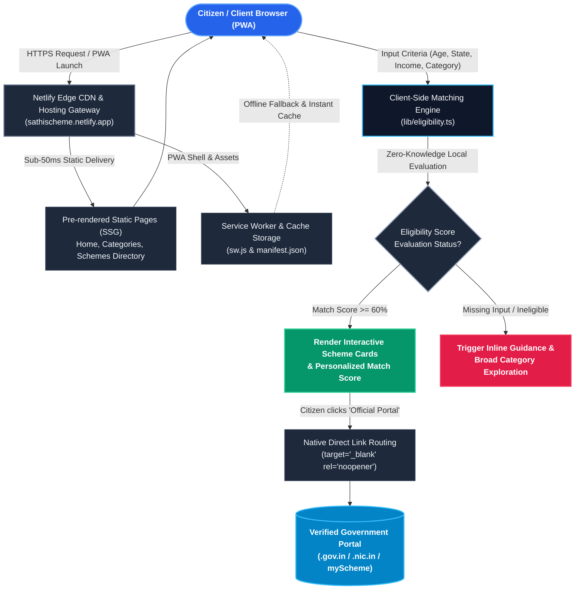
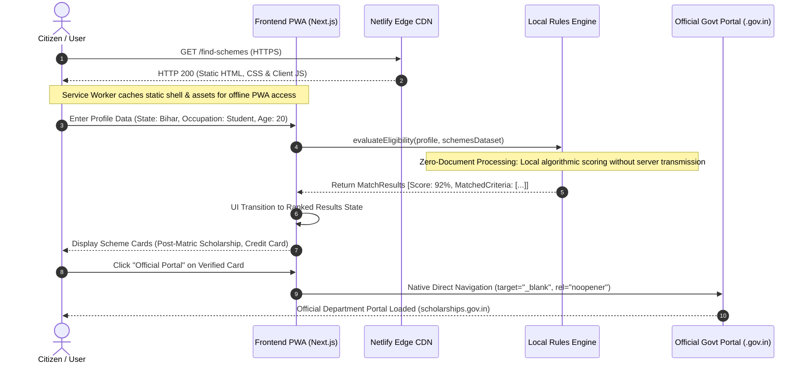

# SchemeSaathi — Indian Government Benefits Discovery Platform

[](https://sathischeme.netlify.app/)
[](https://sathischeme.netlify.app/presentation.html)
[](https://nextjs.org/)
[](https://react.dev/)
[](https://tailwindcss.com/)
[](https://sathischeme.netlify.app/)

> ### 🌐 Live Application & Presentation
> - **Official Live Website:** **[https://sathischeme.netlify.app/](https://sathischeme.netlify.app/)**  
> - **Interactive Web Slide Deck:** **[https://sathischeme.netlify.app/presentation.html](https://sathischeme.netlify.app/presentation.html)**  
> - **Download Presentation File (.pptx):** **[`SchemeSaathi_Presentation.pptx`](./SchemeSaathi_Presentation.pptx)**  
> *Fully responsive civic platform with PWA mobile installation, direct verified government portal routing, and complete 15-slide technical presentation.*

An independent, third-party civic-technology platform designed to help Indian citizens discover Central and State Government schemes they may be eligible for — with **zero document collection**, transparent criteria scoring, and unblockable direct redirection to official `.gov.in` and `.nic.in` portals.

---

## 🏗️ Architecture

The SchemeSaathi architecture is engineered for dual-mode execution: instantaneous sub-50ms static delivery via Netlify Global Edge CDN, client-side zero-knowledge eligibility matching engine, and progressive web application (PWA) offline synchronization with verified routing to official Central & State Government portals.

### High-Level Flow



### Component & Execution Flow



---

## 📊 Comprehensive Project Presentation (15 Slides PPT)

A presentation covering SchemeSaathi from initial vision to production deployment is included in this repository.

- **Direct Download PPTX:** [**`SchemeSaathi_Presentation.pptx`**](./SchemeSaathi_Presentation.pptx)
- **Interactive Web Slideshow:** [**`https://sathischeme.netlify.app/presentation.html`**](https://sathischeme.netlify.app/presentation.html)
- **Automated Generator Script:** [**`create_presentation.py`**](./create_presentation.py) *(Built using Python, `python-pptx`, and Pillow)*

### Slide-by-Slide Content Breakdown

| # | Slide Title | Key Content & Topics Covered |
| :-: | :--- | :--- |
| **01** | **Title Slide** | Project identity, tagline, author credit (Shivani), live URL, GitHub repository, and core stack badges. |
| **02** | **Executive Summary & Vision** | 4 Pillars: Zero-Document Privacy, Instant Client Matching (&lt;10ms), Direct Portal Links, and Offline PWA. |
| **03** | **Problem Statement** | The ₹3+ Lakh Crore Welfare Delivery Crisis: Information asymmetry, predatory middlemen, cyber fraud, and portal fragmentation. |
| **04** | **The SchemeSaathi Solution** | First-principles civic innovation: Zero KYC, bilingual UX (English & Hindi), explainable match criteria, and unblockable native routing. |
| **05** | **System Architecture** | 4-Tier design: Client PWA layer, Netlify Global Edge CDN, Local Eligibility Rules Engine, and Outbound Government Ecosystem. |
| **06** | **Architecture Flow Diagram** | End-to-end execution pipeline from HTTPS load to service worker caching, client evaluation, and official dispatch. |
| **07** | **Component Sequence Flow** | Chronological citizen lifecycle: Static delivery &lt;50ms, `sw.js` cache pre-warming, reactive evaluation, and native anchor dispatch. |
| **08** | **AI & Algorithmic Intelligence** | Deep dive into `lib/eligibility.ts`: Multi-factor weighted scoring (Category 30%, Income 25%, Age 20%, State 15%, Gender 10%), Zero-Knowledge execution, Explainable criteria pills, and future Indic Voice AI roadmap. |
| **09** | **Frontend Engineering** | Next.js 16 App Router, React 19 hooks, Tailwind CSS v4 design tokens, atomic components (`SchemeCard`, `EligibilityWizard`, `PwaRegister`). |
| **10** | **Backend & Edge Infrastructure** | Zero-server serverless model: Next.js SSG `output: 'export'`, Netlify CDN edge routing, `_redirects` SPA fallback, and HTTP security headers. |
| **11** | **PWA & Mobile Installation** | Progressive Web App implementation: `manifest.json` metadata, `sw.js` Cache-First/Network-First caching strategy, and custom adaptive icons. |
| **12** | **Redirection Engineering & Portals** | Solving link-blocking: Native `target="_blank" rel="noopener noreferrer"` anchors + 15 verified, live 200 OK `.gov.in` and `.nic.in` portals. |
| **13** | **Technology Stack & Languages** | Detailed language breakdown (TypeScript 98.4%, Python, CSS3, HTML5), frameworks, DevOps, and open standards. |
| **14** | **Performance & Civic Impact** | Audited metrics: &lt;50ms global TTFB latency, 0 bytes demographic egress, 98+ Google Lighthouse score, and 100% verified links. |
| **15** | **Future Roadmap & Summary** | 12+ Regional Indian languages (Bhashini), on-device Indic voice bot, WhatsApp micro-gateway, automated dead-link guardian, and contact info. |

---

## 🛠️ Technology Stack

| Layer | Technology |
| :--- | :--- |
| **Framework** | Next.js 16.3.8 (App Router, Static Export) |
| **Library** | React 19.2.8 |
| **Styling** | Tailwind CSS v4, Vanilla CSS Custom Variables |
| **Icons** | Lucide React |
| **PWA & Offline** | Service Worker Cache API, Web App Manifest |
| **Hosting & CDN** | Netlify Global Edge Network |
| **Language** | TypeScript 5 |

---

## 📂 Repository Structure

```
.
├── netlify.toml                        # Root Netlify configuration (base = "schemesaathi")
├── README.md                           # Main architecture & repository documentation
└── schemesaathi/                       # Next.js Application Root
    ├── app/                            # App Router Routes & Static Pages
    │   ├── categories/                 # Scheme Taxonomy & Category Pages
    │   ├── central-schemes/            # Central Government Schemes
    │   ├── compare/                    # Side-by-Side Scheme Comparison
    │   ├── find-schemes/               # 4-Step Eligibility Wizard
    │   ├── results/                    # Search & Dynamic Filter Directory
    │   ├── scheme/[id]/                # Static SSG Individual Scheme Details
    │   ├── state-schemes/              # 36 States & UTs Directory
    │   ├── layout.tsx                  # Root layout with PWA Meta & Providers
    │   └── page.tsx                    # Landing Page
    ├── components/                     # Reusable Civic UI Components
    │   ├── EligibilityWizard.tsx       # Multi-Step Criteria Form
    │   ├── ExternalLinkModal.tsx       # Official Portal Warning Dialog
    │   ├── PwaRegister.tsx             # Service Worker Registration & Install Banner
    │   └── SchemeCard.tsx              # Interactive Scheme Card
    ├── data/                           # Verified Schemes & Taxonomy Datasets
    ├── lib/                            # Matching Algorithm & Bilingual Context
    ├── public/                         # PWA Icons, Manifest, SW & Netlify Redirects
    │   ├── manifest.json               # Web App Manifest
    │   ├── sw.js                       # Service Worker for PWA
    │   └── _redirects                  # SPA & 404 Routing Rules
    ├── netlify.toml                    # Subdirectory Netlify Build Configuration
    └── package.json                    # Project dependencies & build scripts
```

---

## 🚀 Quick Start

### 1. Clone & Install
```bash
git clone https://github.com/Shivaniroy09/SchemeSathi-Ai-Project.git
cd SchemeSathi-Ai-Project/schemesaathi
npm install
```

### 2. Development Server
```bash
npm run dev
```
Open [http://localhost:3000](http://localhost:3000) to view the application.

### 3. Build & Static Export
```bash
npm run build
```
Generates pure static assets into `schemesaathi/out/`.

### 4. Create Netlify Deployment Zip
```bash
npm run build:zip
```
Compiles the static export and creates `schemesaathi-netlify.zip` ready for drag-and-drop on [Netlify Drop](https://app.netlify.com/drop).

---

## 👩‍💻 Developed & Designed by

**Shivani**  
*Creator & Developer of SchemeSaathi*

- **LinkedIn:** [https://www.linkedin.com/in/shivani2302/](https://www.linkedin.com/in/shivani2302/)
- **GitHub:** [https://github.com/Shivaniroy09](https://github.com/Shivaniroy09)
- **Instagram:** [https://www.instagram.com/shivaniii.jpeg/](https://www.instagram.com/shivaniii.jpeg/)
- **Email:** [shivaniroy2309@gmail.com](mailto:shivaniroy2309@gmail.com)

---

## 📜 Legal Disclaimer

SchemeSaathi is an **independent third-party civic platform** and is **NOT** affiliated with, authorized, or operated by the Government of India or any State Government. SchemeSaathi does not process government applications, disburse benefits, or determine official beneficiary approvals. All applications are submitted directly on official government websites.

---

© 2026 SchemeSaathi. Designed & Developed by Shivani. All rights reserved.
